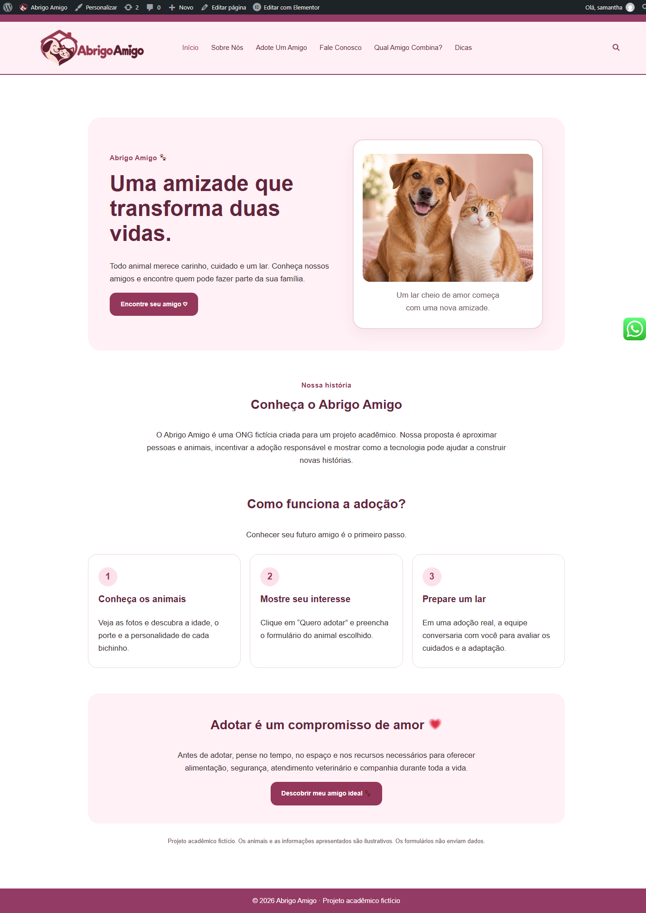
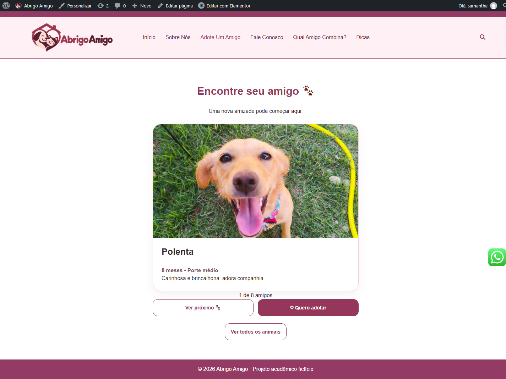
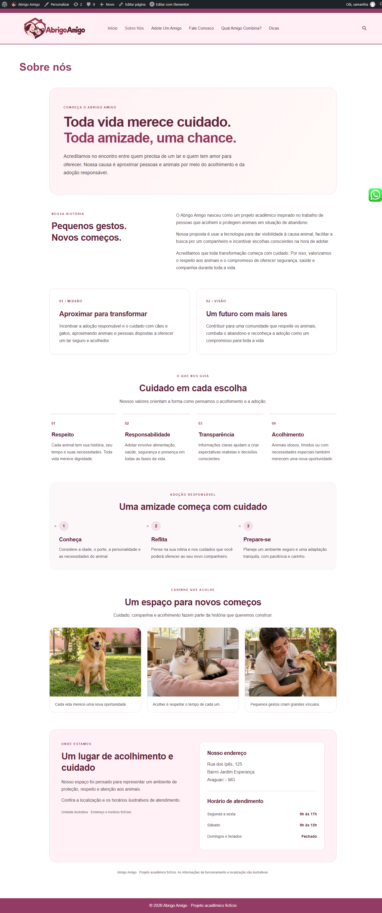
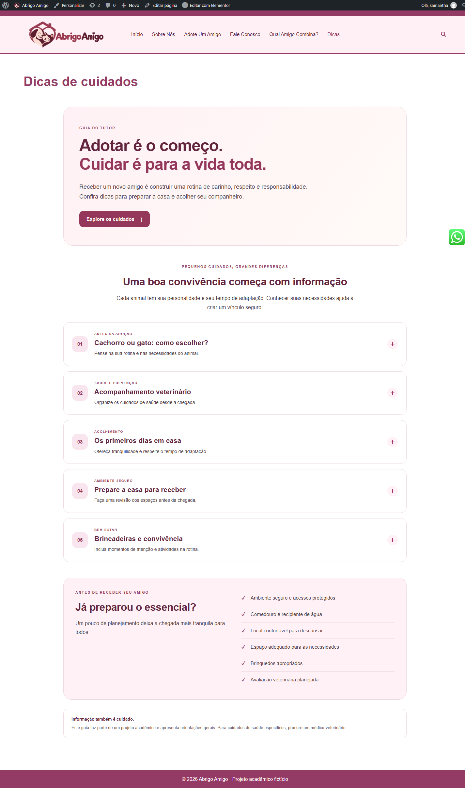
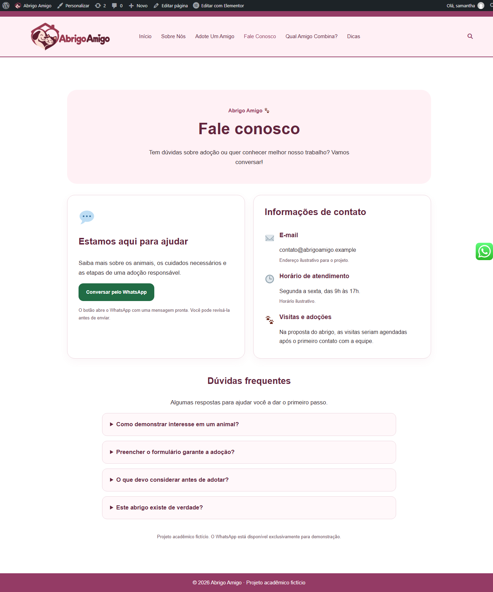
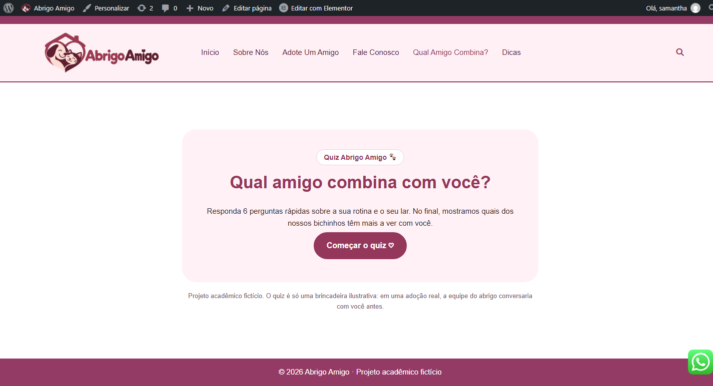
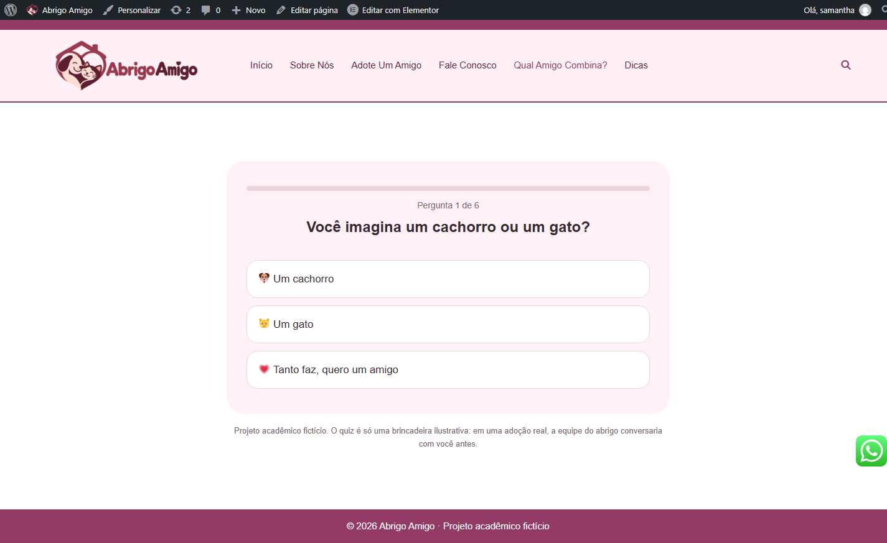
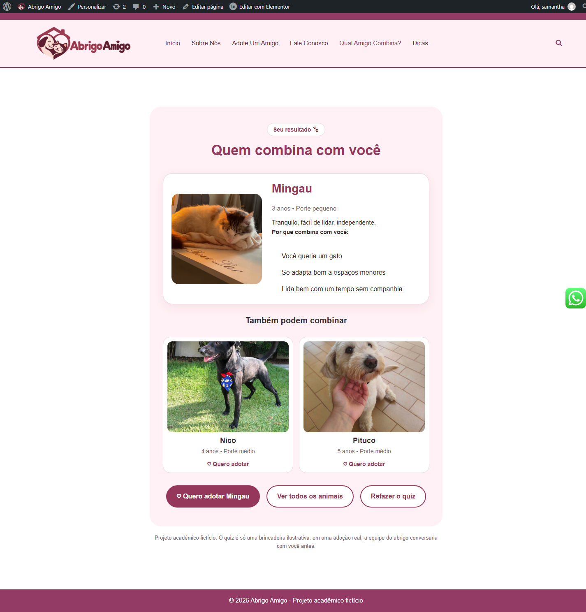

# Abrigo Amigo 🐾

Site acadêmico de uma ONG fictícia de proteção animal, desenvolvido
para a disciplina de UX Design do curso de Análise e Desenvolvimento
de Sistemas.

O projeto busca aproximar pessoas e animais por meio de uma interface
acolhedora, inspirada no aplicativo tinder, informações sobre adoção responsável e um quiz interativo.

## Funcionalidades

- Apresentação do abrigo e de sua proposta.
- Catálogo de animais com fotos e descrições.
- Formulário demonstrativo de interesse em adoção.
- Quiz “Qual amigo combina com você?”.
- Guia de cuidados com os animais.
- Página de contato e acesso ao WhatsApp no site WordPress.
- Layout adaptado para diferentes tamanhos de tela.

## Telas do projeto

### Início

### Adoção

### Sobre nós

### Cuidados

### Contato

### Quiz

## Tecnologias e ferramentas

- WordPress
- Elementor
- HTML
- CSS
- JavaScript
- LocalWP para execução local

## Organização do repositório

- `paginas/`: códigos personalizados das páginas.
- `imagens/`: imagens utilizadas no projeto.
- `screenshots/`: capturas do site no WordPress.
- `README.md`: apresentação e documentação.

## Visualização

O site completo foi montado no WordPress. Este repositório reúne
os códigos personalizados, imagens e capturas do resultado.

Os arquivos HTML podem ser abertos individualmente no navegador.
Eles não incluem o tema, o cabeçalho, o rodapé e as funcionalidades
dos plugins do WordPress.

Este repositório não contém uma instalação completa do WordPress
nem uma cópia de seu banco de dados.

## Quiz

O quiz apresenta seis perguntas sobre preferências, rotina e ambiente
do usuário. As respostas atribuem pontos às características dos animais
e geram sugestões ilustrativas de compatibilidade.

## Demonstração acadêmica

O Abrigo Amigo é uma ONG fictícia. Os formulários de adoção são
demonstrativos e não enviam dados. O resultado do quiz não substitui
uma avaliação real para adoção responsável.

## Autores

- Samantha Silva Cestarioli — [GitHub](https://github.com/SamanthaSCest)
- Kennedy Fagundes dos Santos — [GitHub](https://github.com/kennedyfagundes86-droid)

Projeto desenvolvido em conjunto para a disciplina de UX Design
do curso de Análise e Desenvolvimento de Sistemas.